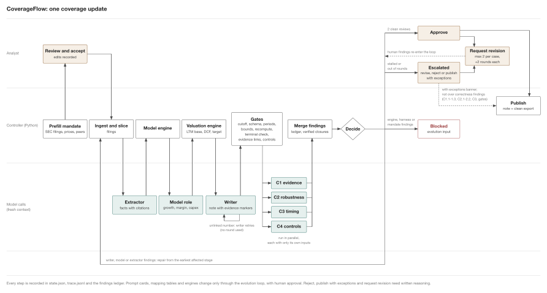
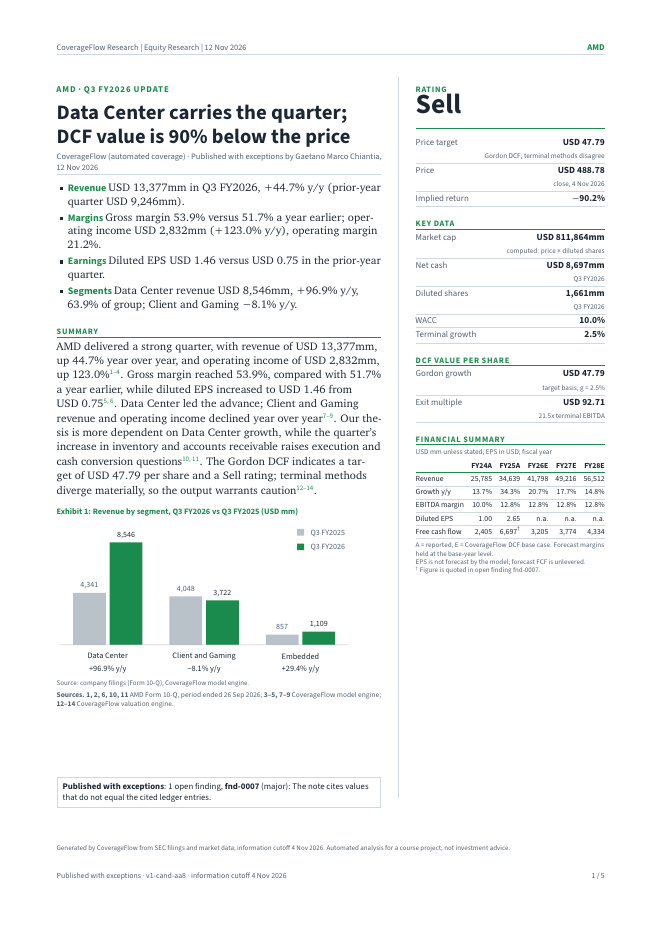
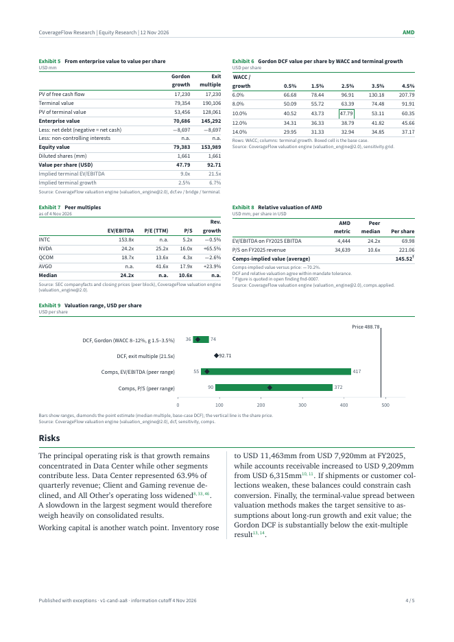

# CoverageFlow

**A long-running agent workflow that keeps sell-side equity coverage up to date.**

AI Coding in Finance (Fall 2026), final project.

**Author:** Gaetano Marco Chiantia · **Student ID:** 25210660138

**Repository:** <https://github.com/Fner-hjw/aic-coverageflow>. The submission ZIP contains the same repository with its complete `.git/` history, so everything can be reviewed offline.

---

## In one paragraph

When a covered company files a new 10-Q, 10-K or 8-K, an analyst has to update the financial model, the valuation and the research note, check every number against the filing, and get the update approved before it goes out. CoverageFlow does that update as a **persistent, checkpointed case**: language models read the filings and write the note, **deterministic Python** does every calculation, **four independent critics** and **ten numerical gates** check the result, a **bounded revision loop** repairs what they find, and **a human approves** before anything is published. Every step is recorded, an interrupted run resumes without redoing finished work, nothing dated after the information cutoff can enter the case, and changes to the system itself are regression-tested before they become active. The output is a versioned, evidence-linked research note (PDF and HTML) plus an Excel model.



*The workflow of one coverage update. Analyst lane (top): mandate review, the human decision (approve, request revision, reject, or publish with exceptions). Controller lane (middle): deterministic Python, including the engines and gates. Model-call lane (bottom): fresh-context agent calls. A PNG copy is at `docs/workflow-diagram.png`; `scripts/gen_diagram.py --svg` regenerates both.*

## What it produces

A sample output from a real run on AMD's Q3 FY2026 10-Q (live model calls, real filings), re-rendered from the case's saved artifacts:

| Cover page | Valuation page |
|---|---|
|  |  |

- `docs/sample-note/amd-fy2026q3r3-20261104-v1-cand-aa8-dossier.pdf`: the 5-page note (cover with rating sidebar; results and segment exhibits; DCF, EV bridge, WACC × growth sensitivity, peer comps, football field; risks; sources and controls appendix with input hashes, evidence references and the decision record).
- `...-dossier.html`: the same note as one self-contained HTML file.
- `...-model.xlsx`: the Excel model (statements, DCF, comps, ratios).

This particular case was *published with exceptions*: the human approver signed off over one open critic finding (fnd-0007, a cited value that did not match its evidence key). The note says so on its cover and in its appendix. That episode led to two of the last changes: the gate that now catches this error class, and a rule that forbids publishing over it (see [Human decision](#5-human-decision-the-only-route-to-publication) below).

## How it works

### 1. A case and its inputs

A **case** is one coverage update: a ticker, a trigger filing, an **information cutoff date**, a **frozen input bundle** (SEC filings snapshotted from EDGAR with SHA-256 hashes, `data/*-bundle/`) and a **mandate** (valuation assumptions, forecast bounds, budgets). The mandate is human-owned: market data (price, peers, beta, risk-free rate) can be prefilled by code with provenance, but a person must review and accept it before the case can run.

### 2. Generators: agents that read and write, engines that compute

| Stage | Who | Output |
|---|---|---|
| Ingest and slice | controller code (deterministic slicer) | statement slices per filing |
| Extraction | **extractor** agent, fanned out per statement | `facts.json`: every figure with a citation (doc, slice, anchor) |
| Model | **model** agent proposes segment growth and margin paths within mandate bounds; the **model engine** (Python) builds ~80 canonical series | `forecast_assumptions.json`, `model.json` |
| Valuation | **valuation engine** (Python): DCF with Gordon and exit-multiple terminal values, comps, sensitivity, rating | `valuation.json` |
| Note | **writer** agent; every number must carry an `[EV:<key>]` evidence marker | `report.md` |

Agents never do arithmetic that matters: they propose and describe, the engines compute. Each agent call is a fresh context with a versioned role card (`prompts/`), pinned references (`references/`) and only the inputs its role needs.

### 3. Checks independent of the producer

- **Ten deterministic gates** (`coverageflow/gates.py`): input cutoff, facts schema, citation presence, period coverage, forecast bounds, candidate manifest integrity, recompute, terminal reconciliation, report evidence links (every number cites a key, and the cited key holds that value), and controls conformance.
- **Four critics**, run in parallel, each with its own checklist from the locked rubric (`references/critic-rubric-v1.1.md`): C1 evidence, C2 robustness of the numbers, C3 timing and cutoff, C4 controls and risks.
- **Findings ledger** (`findings.json`): every finding gets a unique ID, a severity and an **owner** (writer, model, extractor, system or mandate). A finding is closed only when a critic verifies the repair against the artifact's SHA-256, never because a critic stopped mentioning it.

### 4. The bounded revision loop

Open findings owned by a role become a **repair packet**, and the case rebuilds from the earliest stage those findings touch. A writer-only gate failure is repaired at the writer without spending a review round. Findings owned by the system or the mandate stop the case (`BLOCKED`) and become input for an evolution proposal, since no rebuild can fix them. The loop ends in one of four ways:

- **Accepted:** two consecutive clean reviews of the same candidate → `PENDING_APPROVAL`.
- **Escalated:** rounds run out or progress stalls with a fully reviewed candidate → `ESCALATED`, for a human to adjudicate.
- **Exhausted:** a budget (tokens, minutes, retries) is breached → `EXHAUSTED`; a human can grant more budget explicitly.
- **Blocked:** missing inputs, an unavailable backend, or a defect no role can repair → `BLOCKED` with a precise reason.

### 5. Human decision: the only route to publication

| Decision | When | Effect |
|---|---|---|
| **Approve** | after two clean reviews | publishes `report/vN-<candidate>.md`, case `CLOSED` |
| **Request revision** | pending approval or escalated | your objections enter the ledger as human findings with an owner; up to 2 requests per case, +2 rounds each; the critics verify the fix like any other finding |
| **Reject** | any time at the gate | case closed, nothing published |
| **Publish with exceptions** | escalated only | published under a banner listing every open finding, recorded as `PUBLISHED_WITH_EXCEPTIONS`, never `APPROVED` |

Reject, request revision and publish with exceptions need written reasoning (at least 15 characters). **Correctness findings cannot be waived**: if an open finding says a number has no source or a wrong one (C1.1-C1.3), differs from the engines or breaks the bounds (C2.1-C2.2), uses post-cutoff information (C3), or comes from a gate, publishing with exceptions is refused and the approver must request a revision or reject. Judgment calls stay waivable.

### 6. Long-running operation

- **State and checkpoints:** `state.json` with `history/checkpoint-*.json`, an append-only `trace.jsonl` with a fixed event vocabulary, and every artifact written atomically with its SHA-256.
- **Resume:** kill the process at any point; `resume` verifies what is on disk, discards torn partial writes and re-dispatches only the pending role (evidence run 3).
- **Request binding:** every dispatch gets a request ID the agent must echo; stale answers are rejected.
- **Budgets:** per-role tokens, case minutes, review rounds (6) plus mechanical rounds (4), retries per role (3), per-call timeouts, an approval deadline (48 h), optional USD caps. A breach ends the case `EXHAUSTED`, never accepted.
- **Backend pinning:** a case keeps the backend it was started with (offline stub, replay, a headless CLI such as Claude Code or Codex, or an OpenAI-compatible API); the CLI and the UI refuse to switch it silently.
- **Triggers:** a new dated filing opens a new case; the writer receives the previous published note and its headline values as `prior.*` evidence.

### 7. No future-information leakage

The cutoff is enforced in code: the input manifest is gated against it, market data is taken only as of the cutoff, SEC company facts only if filed on or before it, and critic C3 checks the note for post-cutoff references. Evidence run 4 injects a post-cutoff 8-K and shows the gate rejecting it.

### 8. Improving the system safely (evolution)

Prompt cards, mapping tables and engine versions live in a version registry. A proposed change is regression-tested against a fixed baseline case, needs human approval to become the active version, is refused if it touches the locked controller scope, and can be rolled back (evidence run 5).

## Where each requirement is answered

| Requirement | Where |
|---|---|
| 1. Task specification (user, process, stages, triggers, inputs, cutoffs, products, acceptance) | `docs/task-spec.md`; locked design record in `docs/design-decisions.md` |
| 2. Architecture: diagram and design note mapped to the lecture concepts | `docs/workflow-diagram.svg` / `.png`, **`docs/design-note.md`** |
| 2. Roles, handoffs, deterministic code vs agent decisions | design note §roles; `prompts/`, `coverageflow/orchestrator.py`, engines |
| 2. Long-running operation (state, resume, retries, stops, limits) | design note; `statestore.py`, `resume.py`, `budget.py`; evidence run 3 |
| 2. Verification and improvement (independent checks, human approval, bounded loop, baseline testing, versioning, rollback, leakage) | design note; `gates.py`, `ledger.py`, `registry.py`; evidence runs 1, 2, 4, 5 |
| 3. Code, prompts, configuration, example inputs and outputs | this repository; `examples/`, `docs/sample-note/` |
| 3. Evidence of verification and recovery | `examples/run1` to `run5` (offline, reproducible), `examples/run6-amd-live` (live runs) |
| What live runs exposed and what was changed | `docs/live-run-hardening.md`, `docs/diagnosis-2026-11-11.md` |

## Quick start

```bash
python3 launch.py
```

The launcher creates the virtualenv and installs dependencies on first run, asks once which backend to use (**offline demo** needs no account or keys: everything runs for real except the model calls, which are scripted; or an OpenAI-compatible API; or a logged-in headless CLI: `claude`, `codex`, `kimi`, `vibe`), creates a workspace with a ready-to-run Intel case, starts the web UI and opens it. Answers are saved to `.coverageflow-launch.json` (`--configure` to redo them). Flags: `--port N`, `--no-browser`, `--yes`.

In the UI: open the Intel case, press **Run**, watch the rounds, gates, critics and trace, then decide on the **Approval** tab and export the note as PDF, HTML or Excel.

### Manual setup

Python 3.11+. The test suite and the five offline evidence runs need no network access.

```bash
python3 -m venv .venv
.venv/bin/pip install -r requirements.txt
.venv/bin/python -m pytest -q            # 1053 tests, offline
```

`requirements.txt`: `pytest`, `openpyxl`, `fastapi`, `uvicorn`, `httpx`, `websockets`, `matplotlib` (charts in the note and the diagram; the note renders without charts if it is missing). The PDF needs `pdflatex` (TeX Live with the XCharter and Source Sans fonts); without it the `.tex` source is the deliverable.

## Walkthrough (CLI)

All controller actions go through the orchestrator; the CLI never writes state files directly.

```bash
WS=examples/run1-clean; CASE=intc-fy2026q3-20261030

# 1) create a case from the frozen Intel bundle (cutoff = filing date)
.venv/bin/python -m coverageflow --workspace $WS case new \
    --ticker INTC --period fy2026q3 --trigger-doc intc-10q-2026q3 \
    --cutoff 2026-10-30 --manifest $WS/inputs-manifest.json

# 2) run the loop: build -> gates -> 4 critics -> merge -> repair or accept
.venv/bin/python -m coverageflow --workspace $WS run --case $CASE

# 3) the human gate
.venv/bin/python -m coverageflow --workspace $WS approve --case $CASE \
    --decision APPROVED --by "Your Name" --reason "Quarterly update verified."
#    or send it back with your own findings:
.venv/bin/python -m coverageflow --workspace $WS approve --case $CASE \
    --decision REVISION_REQUESTED --by "Your Name" \
    --reason "Valuation paragraph ignores the buyback; the critics missed it." \
    --finding "writer:Valuation ignores the Q3 buyback"

# 4) export the note (PDF + .tex + clean markdown) from the verified artifacts
.venv/bin/python -m coverageflow.export_dossier --case $WS/cases/$CASE

# other verbs: case list|prefill|review|accept|stop · resume · gates · backends
#   demo seed-finding|kill-stage|perturb · evolve prepare|propose|regress|approve|rollback
```

Each case leaves its full record under `cases/<case_id>/`: `mandate.json`, `state.json` + `history/`, `trace.jsonl`, `findings.json`, `rounds/round-NNN/` (generator artifacts, critic reports, repair packets), `approvals/`, `report/` and `export/`. Exports are named `<case_id>-<version>-<kind>[-DRAFT].<ext>` (`dossier` for the note, `model` for the workbook), so a file taken out of the folder still identifies its case and version; anything not yet approved carries `-DRAFT` and a watermark.

## Evidence runs

Start at `examples/README.md`; each offline run has a `commands.sh` that reproduces it with the real engines and scripted model responses.

1. **run1, clean update** (`examples/run1-clean`): create → run → all gates pass, two clean reviews → `PENDING_APPROVAL` → human approval → `CLOSED`, plus the export.
2. **run2, seeded finding → verified closure** (`examples/run2-seeded-repair`): a seeded finding is carried to the critics and closes only against artifact + SHA-256 evidence.
3. **run3, kill mid-run → resume** (`examples/run3-kill-resume`): the run dies during a dispatch; `resume` discards the torn write and re-dispatches only the pending role.
4. **run4, no-leakage perturbation** (`examples/run4-perturbation`): re-runs are byte-identical, and a post-cutoff 8-K injected into the manifest is rejected by the gate.
5. **run5, evolution** (`examples/run5-evolution`): a scoped change passes regression and is approved; an over-broad change is refused; an approved version is rolled back and a case runs under the rolled-back version.
6. **run6, live AMD runs** (`examples/run6-amd-live`): five live Codex cases on AMD's filings, from the first exhausted run to the last escalated one, which drove the hardening documented in `docs/live-run-hardening.md`.

## Development history

The Git history (about 180 commits, 9-12 November 2026) has three phases:

- **Build (9-10 Nov):** contracts first, then the controller, gates, budgets, ledger and resume; the agent layer and backends; the engines and slicer; the web UI; the five offline evidence runs and the design note.
- **First live diagnosis (11 Nov):** a live Intel case that never converged was analysed (`docs/diagnosis-2026-11-11.md`). Fixes: unique ledger IDs, finding owners with partial rebuilds, critic-verified closure only, role-scoped compact prompts, the stall rule, `ESCALATED` as its own status, mandate prefill with provenance, input sanitising.
- **Live hardening and the human loop (12 Nov):** live AMD runs drove extraction fan-out, writer repairs without spending rounds, engine repairs, budgets from measurements (`docs/live-run-hardening.md`). Then: the cited-value gate, a fix for critic repairs being rejected as stale, backend pinning in the UI, **request revision**, required reasoning, **non-waivable correctness findings**, and the **redesigned PDF/HTML research note**.

## Web UI

`python3 launch.py`, or manually:

```bash
.venv/bin/python -m uvicorn ui.api:app --port 8765                 # demo data
COVERAGEFLOW_WORKSPACE=<workspace> .venv/bin/python -m uvicorn ui.api:app --port 8765
```

It covers the case dashboard, starting coverage (mandate form with market-data prefill), the EDGAR bundle builder, run control and live monitoring (rounds, gates, findings, trace, budgets and per-role tokens), the approval dossier with the human decision, exports, version diffs, evolution, run replays, and backend selection. Every action goes through the controller; the UI cannot bypass a gate.

## Configuration

- **Backends:** `stub` (offline), `replay` (recorded responses matched by role and prompt hash), headless CLIs (`claude -p`, `codex exec`, `kimi`, `vibe -p`, using the machine's own login), or an OpenAI-compatible API via `COVERAGEFLOW_BASE_URL`, `COVERAGEFLOW_MODEL`, `COVERAGEFLOW_API_KEY` (or `.coverageflow.json`, which is gitignored). `python -m coverageflow backends` reports what is available.
- **Mandate prefill:** `python -m coverageflow case prefill INTC --cutoff 2026-10-30` proposes price, peers and multiples, beta, risk-free rate and WACC, each with its source, URL, as-of date and hash (Stooq/Yahoo, FRED or Treasury, SEC company facts filed before the cutoff). `case review` and `case accept --set path=value` record the human's edits; a proposed mandate cannot run.
- **SEC access:** set `COVERAGEFLOW_SEC_USER_AGENT="Your Name your@email"` before searching or freezing live filings.

## Repository guide

| Path | What it is |
|---|---|
| `coverageflow/orchestrator.py` | the controller state machine: build, gates, critics, merge, repair, acceptance, escalation, the human gate |
| `coverageflow/gates.py`, `ledger.py`, `budget.py`, `statestore.py`, `resume.py`, `registry.py` | gates; findings ledger with owners and the non-waivable rule; budgets; atomic state and trace; verified resume; version registry |
| `coverageflow/dispatch.py`, `_prompt_assembly.py`, `backends/` | role-call envelope, prompt assembly, output validation; backend adapters (CLI, API, replay, stub) |
| `coverageflow/slicer.py`, `extraction.py`, `model_engine.py`, `valuation_engine.py` | deterministic slicing, extraction-unit handling, the model and valuation engines |
| `coverageflow/report_doc.py`, `render_note_tex.py`, `render_note_html.py`, `report_exhibits.py`, `note_charts.py`, `note_build.py`, `export_dossier.py`, `export_xlsx.py` | the research note (one structured document rendered to PDF and HTML) and the Excel model |
| `coverageflow/mandate_prefill.py`, `market_data.py`, `bundle.py`, `cli.py` | mandate prefill with provenance, market data, EDGAR bundles, the CLI |
| `ui/` | FastAPI service, WebSocket push, no-build JavaScript UI |
| `prompts/` | versioned role cards: ingest, extractor, model, writer, critics C1-C4 |
| `references/` | harness preamble, critic rubric, model and mandate schemas, segment mappings, accounting definitions, note template |
| `data/intel-bundle/`, `data/amd-bundle/` | frozen EDGAR snapshots with manifests and hashes |
| `examples/` | the evidence runs |
| `docs/` | task spec, design note, design decisions, contracts, diagnosis, hardening log, diagram, sample note |
| `scripts/` | bundle fetcher, diagram generator, evidence curation, prompt measurement, ZIP builder |
| `tests/` | 1053 offline tests |

## Testing

```bash
.venv/bin/python -m pytest -q
```

1053 tests cover the state machine, gates, ledger, budgets, resume, registry, engines, slicer, extraction, dispatch and prompt assembly, backends (including record/replay), the human decisions (revision, reasoning, non-waivable findings), the note and workbook exports, the API and UI service, and input sanitising. No test needs network access or a model.

## Limitations

- **Local, single-user tool:** one orchestrator per case directory, no scheduler service, no authentication on the UI.
- **Live runs need your own model access:** runs 1-5 use scripted responses; run 6 is a recorded live run and re-running it needs a logged-in `codex` CLI. Live runs cost money (the budget caps tokens, time and optionally USD).
- **No live case reached an approved publication:** the final AMD case was escalated, and the sample note above was published with exceptions before the reasoning and non-waivable rules existed; today it would be refused (`docs/live-run-hardening.md`).
- **Model coverage:** facts come from statement and segment tables; MD&A-only disclosures are noted, not modelled. The model has no EPS forecast and holds forecast EBITDA margins at the base year; the note shows "n.a." where data is missing.
- **CLI `ui` and `export` verbs are placeholders:** use `launch.py` and `python -m coverageflow.export_dossier` (or the UI's export buttons).

## My contribution

I chose the task, wrote the task specification and the design (roles, controller, gates, ledger, budgets, human gate, evolution), and froze the contracts in `docs/contracts/`. The code was written with AI coding agents working as parallel streams against those contracts: runtime and engines, controller, agent layer, web UI, and docs and evidence, integrated by a coordinator stream. I directed each stream, reviewed every change, ran and diagnosed the live cases, and made the design calls that came out of them: the finding owners and partial rebuilds, the escalation status, the request-revision loop, the non-waivable correctness rule, and the report redesign. I own the final work product.

## Credits

- The three supplied course Excel templates (`Complete Quantitative Analysis`, `Discounted Cash Flow Template`, `Stock Analysis Tool`) set the layout conventions of the Excel export: line-item naming, ratio rows, the DCF tab (projection, PV, exit-multiple and Gordon terminal values, EV to per-share bridge) and the comps tab.
- The course lecture on long-running workflows (orchestrator, generator and critic roles, harness, loops and gates, finding ledgers, repair packets, version registries), which the design note maps element by element.
- SEC EDGAR for the public filings in the demo bundles.
