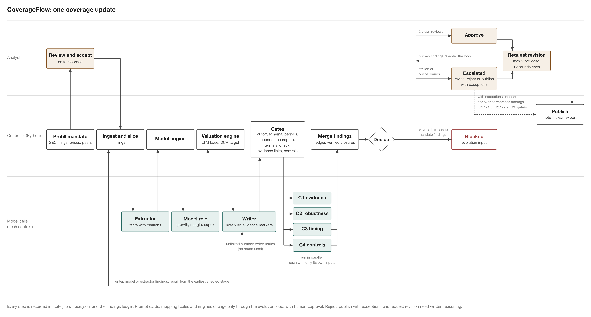

# CoverageFlow — Design Note (Requirement 2)

**Project:** Long-running agent workflow for maintaining sell-side equity coverage
**Course:** AI Coding in Finance (Fall 2026) — Final Project
**Author:** Gaetano Marco Chiantia — Student ID 25210660138
**Design record:** `docs/design-decisions.md` (locked) · **State contracts:** `docs/contracts/state-and-artifacts.md`, `docs/contracts/interfaces.md` (frozen) · **Task:** `docs/task-spec.md`

---

## 1. The workflow, annotated

*(regenerate with `python scripts/gen_diagram.py`; pure matplotlib, no network).*

One **coverage case** turns a dated, frozen, SHA-256-hashed EDGAR document bundle
plus an **information cutoff** (Intel demo: 12 filings, cutoff `2026-10-30`;
AMD held-out bundle: 10 filings) into an updated, independently verified,
human-approved version of the coverage note. The figure reads top-to-bottom as
the lecture's slide-4 skeleton: **Orchestrator → Generator → numerical gates →
Critic → merge → repair loop → acceptance → human approval → published version**,
with the **evolution boundary** (version registry) and the **shared state &
evidence layer** underneath. Every box below is annotated with where it lives in
the repository.

### 1.1 Roles and handoffs — why the division

The system is a hierarchy of *roles*, not one model talking to itself. Handoffs
are file-and-schema based: a role submits exactly one artifact (its
**write-scope**, one path, schema-validated on submission), and the next role
sees only what the Orchestrator binds into its request (**read-scope**). This is
the lecture's "roles and handoffs" pattern made mechanical:

| Role | Sees (read-scope) | Writes (write-scope) | Never |
|---|---|---|---|
| **Orchestrator** (pure Python, no LLM) | everything — it is code | `state.json`, `trace.jsonl`, repair packets | be persuaded; the mandate is fixed |
| Generator lead (controller code) | computed artifact hashes | candidate manifest (IDs + hashes) | n/a: no agent |
| Data & Ingest | mandate, new doc, prior manifest | ingest report + slices | network; alter inputs |
| Extraction | slices only | `facts.json` (every fact cited) | invent facts; uncited numbers |
| Model & Valuation | facts + mandate assumptions | forecast proposal; engine artifacts | LLM arithmetic — the math is code |
| Report Draft | facts, model, valuation, findings | `report.md` with `[EV:…]` links | numbers absent from the ledger |
| Critic lead (controller code) | the four critic reports | merged findings (conflicts kept) | n/a: no agent |
| Critics C1–C4 | evidence + fixed criteria; **fresh context every round** | findings | edit candidate artifacts |
| Human approver | dossier + evidence trail | approval record | skipped by the system |

**Why this division.** (1) *Independence of verification* — every critic sees a
freshly assembled context each round (a new CLI/API invocation per role call;
the trace records dispatch ids), so the generator can never prime its own
reviewer. (2) *Containment of the LLM* — the only stage where a model touches
numbers is Extraction, and every fact it emits must carry a citation to a
deterministic slice (`coverageflow/slicer.py`); everything numerical
downstream is code (`coverageflow/model_engine.py`, `valuation_engine.py`).
(3) *The analyst's judgment is bounded, not replaced* — the Model & Valuation
**specialist proposes a per-segment growth path for years 1–5 plus a margin
glide**, each line citing evidence drivers; the human-owned mandate bounds it
(`forecast_bounds`, segment names CCG / DCAI / NEX / Foundry / Altera /
Mobileye; gross-margin floor 0.30, ceiling 0.55); the gate rejects
out-of-bounds paths (`gate_forecast_bounds`, `coverageflow/gates.py`); WACC
(0.104) and terminal growth (0.025) stay human-owned in the mandate, never
automatable. (4) *Leads merge, workers produce* — the critic lead's merge keeps
conflicting findings visible (`conflicts_kept`); the orchestrator trusts
neither the lead nor any single critic alone: "clean" is *recomputed* by the
controller from the four verdicts plus coverage, see `_run_merge_and_decide`
in `coverageflow/orchestrator.py`.

**Agent assembly model.** Each role call = one fresh backend invocation whose
prompt the controller assembles from four versioned parts: the shared harness
preamble (`references/harness-preamble.md`) + the role card (`prompts/*.md`,
hash-checked) + pinned references (exactly what the card's manifest pins,
e.g. `references/critic-rubric.md`, `segment-mapping-v1.json`) + the bound
request data (canonical JSON) — `coverageflow/_prompt_assembly.py`,
`coverageflow/dispatch.py`. A submission with a stale `request_id` is
rejected; an output that fails its schema is a *repairable* invalid
submission, not a crash. There is no in-LLM tool calling in v1: **the harness,
not the model, is in control** — the lecture's harness/agency distinction in
its strongest form.

### 1.2 Deterministic code vs. agent decisions vs. harness control

| Layer | What it does | Where |
|---|---|---|
| **Deterministic code** | EDGAR bundle snapshot + hashing (`bundle.py`), document slicing (`slicer.py`), model building (`model_engine.py`), DCF/comps/sensitivity (`valuation_engine.py`), the 7 numerical gates (`gates.py`), atomic JSON + SHA-256 (`statestore.py`), xlsx/PDF exporters (`export_xlsx.py`, `export_dossier.py`) | `coverageflow/` |
| **Agent decisions** (LLM, fresh per call) | classifying a new document's relevance; extracting cited facts from slices; *proposing* the bounded forecast; drafting the note strictly from evidence; raising findings as critics | dispatched via `backends/` (claude / codex / kimi CLI, OpenAI-compatible API, offline replay) |
| **Harness control** | state machine, routing, budgets, checkpoints, acceptance rules, repair packets, approval gate, version registry | `orchestrator.py`, `budget.py`, `resume.py`, `ledger.py`, `registry.py` |

The rule: **anything that must be reproducible is code; anything that needs
judgment is an agent; anything with authority is the harness** (slides: "loop is
a control topology, prompts are not control").

## 2. The loop: states, rounds, repair packets

Case states (`docs/contracts/state-and-artifacts.md` §1):
`CREATED → RUNNING → PENDING_APPROVAL → APPROVED/REJECTED → CLOSED`, with
terminal `BLOCKED`, `EXHAUSTED`, `STOPPED`. Exhaustion never grants acceptance.
A candidate that passed every gate and was fully reviewed but could not settle
its objections is `ESCALATED` for a human instead. The human gate has four
decisions: `APPROVED` (only from `PENDING_APPROVAL`), `PUBLISHED_WITH_EXCEPTIONS`
(only from `ESCALATED`), `REJECTED`, and `REVISION_REQUESTED`, which is the one
decision that is not terminal: it sends an `ESCALATED` or `PENDING_APPROVAL`
case back to `RUNNING` (see Human approval below).

Per round the orchestrator runs the graph: build stages
(ingest → extraction → model/valuation engines → report draft → candidate
manifest) → **numerical gates** (7, rerun every round:
`input_cutoff`, `facts_schema`, `citation_presence`, `forecast_bounds`,
`candidate_manifest_integrity`, `recompute`, `report_evidence_links`) → four
fresh critic dispatches → critic-lead merge (union + dedup + conflicts kept) →
controller decision:

- **findings remain → repair packet** (`rounds/round-NNN/repair-packet.json`: open findings + required evidence + unchanged criteria + delta-scope statement) and a **full re-build** in the next round — fresh eyes on the target, and stages may short-circuit by emitting hash-match proofs.
- **clean + no open findings → streak count.** *Acceptance:* all gates pass, **2 consecutive clean full reviews of the same candidate** (any candidate change resets the streak; re-reviewing the same candidate consumes no build round), and every carried finding closed by a critic-verified repair. Trace events `FINDING_OPENED` / `FINDING_VERIFIED_CLOSED` / `REPAIR_PACKET_ISSUED` capture the lifecycle; a finding closes **only** on artifact + matching SHA-256 evidence tied to the *current* candidate (`_apply_critic_closures`, `orchestrator.py`) — tampered evidence is rejected and the finding stays open.
- **invalid submission** (schema/stale id): repair at the same role with a new request id, **no round consumed**; the repair budget (`retries_max`, default 3) bounds it, and exhausting it → `EXHAUSTED` with a precise reason.
- **blocks are instructions, not tombstones.** `BLOCKED` is terminal for the *run*, not for the *case*: a re-run clears the block, resets the repair budget for the role that blocked, and resumes from the last verified stage (`_clear_block`). Only `APPROVAL_EXPIRED` needs a fresh human decision instead. Without this a transient backend failure forced a brand-new case, and the workspace filled with dead cases pointing at the same frozen bundle.

Every transition is **state-first**: validate → write `state.json` + checkpoint
(`history/checkpoint-NNNN.json`) atomically → append to `trace.jsonl`. A
conversation's last line never establishes completion; only a verified
artifact plus a written checkpoint does. The full event vocabulary is fixed in
`design-decisions.md` §3 (`CASE_CREATED` … `APPROVAL_RECORDED`), each carrying
ids, hashes, timestamps, backend and token usage.
Evidence: `examples/run1-clean` (clean propagation) and
`examples/run2-seeded-repair` (findings → critic-verified closure); the
repair-packet path with a scripted raising critic is unit-tested in
`tests/test_orchestrator.py`
(`test_findings_open_ledger_and_packet_then_verified_closure_on_repair`).

## 3. Long-running operation

- **Persistence & state.** JSON + JSONL only, atomic writes (temp + `os.replace`), every artifact header carrying request/candidate ids, prompt versions, cutoff and the input manifest reference. Case layout is frozen in the contracts: `mandate.json`, `inputs/+manifest`, `rounds/round-NNN/…`, `findings.json` (append-only ledger), `state.json`, `trace.jsonl`, `approvals/`, `report/`, `history/`.
- **Triggers.** (1) new dated document arrival → new case, cutoff = filing date — exercised by all five evidence runs; (2) scheduled staleness check (note older than N days vs. newest document — designed trigger, the scheduled scanner itself is not implemented in v1); (3) human action (approve / reject / rollback / evolve) — exercised in run5.
- **Checkpoints & resume.** One checkpoint per verified transition. On startup the orchestrator inspects identity + hashes, **discards unverified partial output** (moved to `discarded/`), **re-dispatches the pending role only**, and returns saved artifacts for completed verified stages; a completed case returns its saved result untouched (`resume.py`, `resume_check` in `orchestrator.py`). A corrupted *verified* artifact rolls back to its producing stage only. Evidence: `examples/run3-kill-resume` (kill during the writer stage → resume → only the writer re-ran; earlier artifacts byte-identical).
- **Stop rules / budgets** (`budget.py`, checked at every dispatch, breach → `EXHAUSTED` with a precise record, never acceptance): max **6 review rounds** plus **4 mechanical rounds** (a rebuild that only re-runs the writer for numerical-gate findings is not a review round); **3 retries** per specialist dispatch, counted per round; **120-minute** case clock (booked when the case ends, paused while awaiting the human); **1,200,000 tokens per role** (a runaway guard, sized from live measurements); per-role dispatch timeout. These are the live-run defaults; the original offline-demo values were 4 rounds / 45 min / 60k tokens (see `docs/live-run-hardening.md` for why they were changed). The human gate has its own deadline: **48 hours**; expiry → `BLOCKED` (`APPROVAL_EXPIRED`), and re-approval restarts acceptance from zero — strict, so a stale approval can never publish.
- **Tool limits.** No in-model tools, no network: inputs are restricted to the frozen bundle; post-cutoff documents are *structurally absent* from the case directory rather than filtered by request — cutoff enforcement is a gate (`gate_manifest_cutoff`), not a prompt. Perturbation evidence: `examples/run4-perturbation`.
- **Time/cost metering.** The trace logs backend + tokens in/out per dispatch (`tokens_by_role` in the budget state), so a run's cost profile is itself an auditable artifact. Live backends are switched by config/CLI (`backends/`: `claude`, `codex`, `kimi`, OpenAI-compatible `api` with `COVERAGEFLOW_BASE_URL/MODEL/API_KEY`, and `replay` recordings captured from live runs — the entire test suite and every evidence run are offline).

## 4. Verification and improvement

**Independent verification.** Four critics with disjoint mandates (C1 evidence
& citation; C2 robustness — recompute the model and valuation
independently via the same deterministic engines; C3 timing & cutoff; C4 risk &
controls), each **fresh context every round**, merging under a fixed rubric
(`references/critic-rubric.md`) with conflicts kept rather than silently
deduplicated. The controller re-derives "clean" from the raw verdicts. The
finding ledger (`ledger.py`) is append-only; closures require verified
evidence; a critic that claims a resolution with a wrong hash cannot close
anything (`tests/test_orchestrator.py::test_unverified_closure_does_not_close_finding`).

**Bounded revision.** Revision is a budgeted loop, not a spiral: ≤ 4 rounds,
≤ 3 retries/role, one write-scope per role, and a candidate-id that changes on
*any* candidate artifact change, resetting the clean streak so the two-clean
rule cannot be gamed by interleaving edits.

**Human approval.** Acceptance never publishes: the case pauses in
`PENDING_APPROVAL` with a deadline, and only a recorded human decision
(who/when/what — `approvals/apr-NNNN.json`) produces the published report
version `vA-<candidate8>` plus exports (`model.xlsx`,
`dossier.pdf` via `coverageflow/export_dossier.py` + `references/dossier-template.tex`,
`dossier.html`) from the *same* verified JSON — exports cannot drift from the
record.

*Reasoning is required.* `REJECTED`, `PUBLISHED_WITH_EXCEPTIONS` and
`REVISION_REQUESTED` override or redirect the machine verdict, so the
orchestrator refuses them without written reasoning (at least 15 characters
after trimming; "ok" and "Approved." do not count). A plain `APPROVED` after
two clean reviews keeps its reasoning optional.

*Request revision.* The approver may disagree with the critics, or with an
escalation, without having to publish or reject. `REVISION_REQUESTED` takes
one or more human findings (summary, owner `writer`/`model`/`extractor`,
severity `major`/`critical`). They enter the ledger with `source_critic:
"human"` and `raised_by`, are carried in the repair packet and to the critics
like any critic finding, and close only on a critic's verified resolution:
never on silence. An `owner` of `system` or `mandate` is refused; those follow
the `needs_system_change` / `needs_mandate_change` route. The rebuild restarts
at the earliest stage a finding's owner names. The request resets the
clean-review streak and the stall history, clears the approval deadline (a new
one is set when the case next reaches `PENDING_APPROVAL`), grants 2 extra
rounds as a recorded budget grant, and is written to `approvals/apr-NNNN.json`
and the trace (`REVISION_REQUESTED`) without closing the case. At most 2
requests per case; after that the human publishes with exceptions or rejects.

**No-leakage.** Everything is tied to the cutoff stamped in the immutable
mandate: the input manifest is gate-checked (`gate_manifest_cutoff`), every
artifact header records cutoff + manifest hashes, and the deterministic
engines re-run gate-identically (`demo perturb` asserts both). Post-cutoff
documents are rejected structurally — demonstrated live in
`examples/run4-perturbation` with a deliberately injected post-cutoff
document.

**Evolution under regression testing.** The system itself changes — prompt
cards, segment mapping tables, engine code, templates — but *never* the
controller, gate thresholds, acceptance rules or rubric (a proposal cannot
weaken its own acceptance standard). The loop: `evolve prepare` (links case +
parent version + scope + budget) → scoped patch + tests by the Generator →
**baseline regression on the frozen corpus** (4 development cases across two
companies; 2 Intel/AMD held-out cases never touch development loops) run on
the offline replay backend, never live tokens → fresh-critic review of
evidence, scope, regressions → **version registry entry**
(`versions/registry.json`) → human approve / defer / reject → active-pointer
swap; rollback restores the prior pointer while existing cases keep their
original version, and a new case verifies rolled-back behavior
(`registry.py`; CLI `coverageflow evolve …`; evidence with the recorded
approve + rollback ops: `examples/run5-evolution`). Version ids:
`sys-1.0` (baseline) → `sys-1.1` … ; case state pins
`config_versions` (prompt cards, mapping tables, engines, schema) at creation.

## 5. Concept map — lecture slides → implementation

| Lecture concept | CoverageFlow realization | Code / evidence |
|---|---|---|
| Orchestrator / control | `Orchestrator` state machine: dispatch, routing, budgets, gates, checkpoints; only writer of `state.json`/`trace.jsonl` | `orchestrator.py`, `statestore.py` |
| Generator / Critic roles | 4 build specialists + controller-built manifest; 4 fresh reviewers (C1–C4), fixed rubric, controller-side merge | `orchestrator.py`, `prompts/*.md` |
| Handoffs (roles) | read-scope = bound payload; write-scope = one schema-validated artifact; stale request rejected | `dispatch.py`, §1.1 table |
| Harness (agency control) | prompt assembly from preamble+card+refs+bound request; no in-model tools; budget+timeout per role call | `_prompt_assembly.py`, `dispatch.py`, `budget.py` |
| Loop / graph | CREATED…CLOSED states; per-round graph build→gates→critics→merge→decide; state-first transitions | `orchestrator.py` §2 here |
| Gates | 7 numerical gates, deterministic, rerun per round; invalid submission repairs at role, budget-bounded | `gates.py` |
| Finding ledger | append-only open/closed findings with critic-verified closure evidence (artifact + sha match) | `ledger.py`, `findings.json` |
| Repair packets | findings + required evidence issued by orchestrator → full re-build round (fresh eyes) | `repair-packet.json`, `examples/run2-seeded-repair` |
| Stop rules / budgets / resume | 4 rounds; 3 retries/role; 45 min; 60k tokens/role; 48 h approval; discard-unverified resume of pending role only | `budget.py`, `resume.py`, `examples/run3-kill-resume` |
| Verification & improvement | independent fresh critics; human approval gate; bounded revision; baseline regression; version registry + rollback; cutoff/no-leakage | §4 here, `examples/run4-perturbation`, `examples/run5-evolution` |
| Version registry / evolution | `versions/registry.json`; evolvable = cards/tables/engines/templates (regression-proven), locked = controller/gates/acceptance/rubric; human approve + rollback | `registry.py`, `cli.py` (`evolve`) |
| Evidence trail | per-case `trace.jsonl` with fixed event vocabulary; checkpoints; hashed inputs; replay recordings | contracts §2, `examples/run1-clean/…/trace.jsonl` |

## 6. Where the evidence lives

1. Clean end-to-end coverage update (gates + 2 clean reviews + approval record): `examples/run1-clean`.
2. Seeded finding → repair loop → critic-verified closure: `examples/run2-seeded-repair`.
3. Kill mid-run → resume, only the pending role re-runs: `examples/run3-kill-resume`.
4. Cutoff/no-leakage perturbation (deterministic recompute; post-cutoff document rejected; outputs stable): `examples/run4-perturbation`.
5. Evolution: approve / scope-reject / rollback with verification: `examples/run5-evolution`.

All five were produced offline by running the real controller + deterministic
engines against the frozen Intel bundle (the agent role calls use the offline
replay/stub dispatch, exactly what the demo control panel in the UI labels
"scripted rehearsal"). Unit + regression suite — 976 tests — runs fully offline:
`python -m pytest tests/`.

## 7. Second phase: what live runs changed in the design

The five evidence runs are offline rehearsals. Running the same controller
against real AMD filings with a live backend (Codex) showed failures the
rehearsals could not, and the design moved in five places. Full record,
measurements and commit references: **`docs/live-run-hardening.md`**;
the live cases are in `examples/run6-amd-live/`.

1. **Ownership before repair.** A finding now has an owner (`writer`,
   `model`, `extractor`, `system`, `mandate`) and only the owner may be asked
   to fix it. A defect in a human-owned input ends the case at once as
   `needs_mandate_change`; it is checked *before round 1* when it can be proven
   from the mandate alone (terminal-value feasibility), and a finding that
   returns unchanged after its owner's repair round is reassigned to the
   mandate. This is the "stop and escalate" rule from §3 made specific.
2. **Mechanical vs. review rounds.** Retrying the writer for an unmarked
   number is not review. Those rebuilds draw on their own allowance, and the
   in-round retry is *patch-only*: it gets the previous draft and the flagged
   lines, and only the changes that touch flagged lines are kept.
3. **More verification in code, before any critic.** Besides "every number has
   an evidence marker", the harness now checks that the cited key holds the
   stated value, binds unambiguous numbers to their key itself, and builds the
   ingest report in code when it is a copy of the slicer's output. Strict
   decode-time schemas for the extractor and writer envelopes remove a class of
   invalid-JSON retries.
4. **Independent verification must be able to see the artifact.** The
   consistency critic could not read the forecast proposal, so every claim about
   it was "unsupported"; it can now, and the forecast values are citable.
5. **Honest bookkeeping.** The case clock is booked when a case ends, a
   stopped case no longer shows a running timer, the token meter shows each
   role against the cap it actually runs under, and an escalated case can be
   exported as a clearly marked unapproved draft so the human gate has
   something to inspect.

